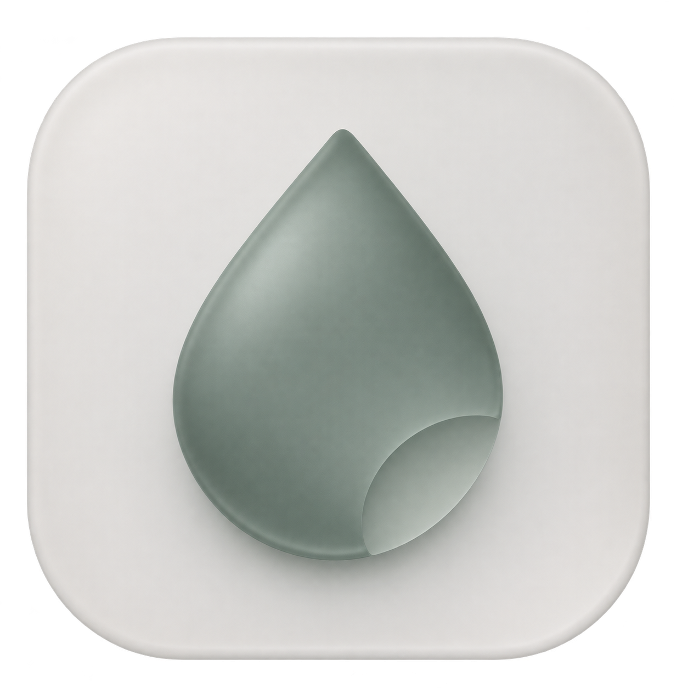

# 小喝 · Shoho



喝一小口，休息片刻。基于 **Tauri 2 + TypeScript + Rust** 的 macOS / Windows 喝水提醒应用。

## macOS 测试版安装

从本仓库的 [GitHub Releases](https://github.com/cavaljames/Shoho/releases) 下载安装包。Apple 芯片 Mac（M 系列）选择文件名包含 `aarch64` 的 DMG；Intel Mac 选择 `x86_64`，以该 Release 实际提供的附件为准。

当前测试版使用临时签名（ad-hoc），尚未使用 Apple Developer ID 签名和完成 Apple 公证，首次打开可能受到系统拦截。

1. 双击下载的 `.dmg`，将 **Shoho 拖入 Applications（应用程序）**。
2. 在 Finder 的「应用程序」中打开 Shoho。
3. 如果提示「无法验证开发者」或「Apple 无法检查」，关闭提示，打开 **系统设置 → 隐私与安全性**。
4. 找到 Shoho 被阻止打开的说明，点击 **仍要打开**，按系统提示验证身份并确认打开。

这些步骤需要先尝试打开一次 Shoho。参考 [Apple 官方操作说明](https://support.apple.com/zh-cn/102445)。

<details>
<summary>提示「已损坏」或没有「仍要打开」时怎么办？</summary>

请先核对下载文件和安装后的 App 完整性，校验失败时重新下载并反馈问题。下面以 Apple 芯片版 `0.3.3` 为例：

1. 下载同版本、同架构的 `.dmg.sha256` 校验文件，与 DMG 放在同一目录。该本地构建的 [0.3.3 Apple 芯片版校验文件](docs/checksums/Shoho_0.3.3_aarch64.dmg.sha256) 也保存在仓库中，可打开链接后点击 GitHub 的「Download raw file」下载。
2. 打开「终端」，进入下载目录并执行校验；如果文件保存在其他目录，请相应调整第一行：

   ```sh
   cd ~/Downloads
   shasum -a 256 -c Shoho_0.3.3_aarch64.dmg.sha256
   ```

   输出应为 `Shoho_0.3.3_aarch64.dmg: OK`。其他版本、架构或重新构建的安装包需要使用对应校验文件。

3. 确保 Shoho 已拖入「应用程序」，再检查 App 签名完整性：

   ```sh
   codesign --verify --deep --strict --verbose=2 "/Applications/Shoho.app"
   ```

   应显示 `valid on disk` 和 `satisfies its Designated Requirement`。这项检查验证文件完整性，不代表经过 Apple 公证。

4. 仅在上述校验均通过、确认应用来自本仓库并信任来源后，可自行执行以下命令，移除 Shoho 的下载隔离标记，再从「应用程序」重新打开：

   ```sh
   xattr -dr com.apple.quarantine "/Applications/Shoho.app"
   ```

   这条命令只作用于上述 Shoho 应用包，不会使应用获得 Apple 公证。

</details>

## 开发

需要 Node.js 22.12+（推荐 24）、Rust stable（最低 1.90）以及系统编译工具：macOS 使用 Xcode Command Line Tools，Windows 使用 Microsoft C++ Build Tools 与 WebView2。

```sh
npm ci
npm start
```

如果系统已有 Cargo，会直接使用系统工具链。本次开发准备的独立工具链放在 `.toolchain/`，启动脚本会在系统找不到 Cargo 时自动使用它，不修改 shell 配置；该目录已加入 Git 忽略。其他开发机器按 [Tauri 官方前置要求](https://v2.tauri.app/start/prerequisites/) 安装 Rust 即可。

`npm run dev` 只启动界面开发服务器；桌面功能需要 `npm start`。普通浏览器没有原生 Tauri 通信接口。

## 架构

- `src/*.ts`：类型明确的界面与 IPC 桥接，使用 Vite 构建，无额外 UI 框架。
- `src-tauri/src/model.rs`：输入校验、本地日期、提醒时段、暂停、目标达成和调度规则。
- `src-tauri/src/storage.rs`：事务式内存更新、原子文件替换、错误恢复和旧版数据导入。
- `src-tauri/src/main.rs`：托盘、原生窗口、后台调度、系统通知、开机启动和单实例管理。

关闭主窗口会销毁 WebView，释放界面资源，Rust 核心和托盘继续运行。托盘左键或右键均展开原生快捷菜单，可直接选取命名水量记录饮水、暂停/恢复或开关提醒，也可以打开主窗口或退出。后台调度使用条件变量等待，平时最多每 30 秒检查一次墙钟与时段，并在目标提醒时间唤醒；界面计时器不负责真正的提醒。休眠、时钟回拨和跨天不会补发积压提醒。提醒浮窗不会主动请求焦点，可直接记录水量或推迟 10 分钟。

## 功能

- 480 × 620 紧凑主窗口：今日进度、命名水量快捷项、最近记录和下次提醒。
- 支持 1–8 个快捷项，可自定义名称（1–12 个字）、水量（10–1000 ml）、默认项；也支持临时命名记录。提醒浮窗直接使用水量按钮选择，无原生下拉控件。
- 记录保留当时的名称与水量；快捷项改名或删除不会改动历史。七天图表可点击筛选当天记录。
- 自定义每日目标、杯量、间隔和提醒时段，支持跨午夜。
- 提醒浮窗、10 分钟后提醒、暂停一小时和手动恢复。
- 当日目标达成后停止提醒；暂停状态与水量记录可跨重启保存。
- 托盘常驻、单实例、开机启动（安装版）与可选系统通知。
- 数据只保存在本机，无需账号，无服务器或埋点。

默认目标 1800 ml，每隔 45 分钟在 09:00–22:00 提醒。初始快捷项为「一口 30 ml」「一杯 200 ml」「一碗 350 ml」，可自行改名、调整水量和增删。升级时会将旧版杯量保留为默认「一杯」快捷项。

## 验证

```sh
npm test
npm run test:ui
```

`npm test` 执行 TypeScript 严格类型检查、前端构建和 Rust 单元测试。Rust 测试覆盖跨日、跨午夜、暂停和重启、休眠和时钟变化、目标达成、快捷项校验、命名记录、默认项持久化、旧杯量迁移、损坏文件备份，以及写入失败时不改变内存数据。

`npm run test:ui` 使用本机 Chrome 与模拟 Tauri IPC，验证紧凑布局、快捷项增删改与默认项、命名记录、撤销、图表筛选、提醒框选择水量与边框绘制、暂停恢复和重载。这个测试仅验证界面，不能替代原生窗口、托盘及系统功能的实机验证。截图输出在 `test-artifacts/`。

## 打包

```sh
# 在 macOS 构建当前架构的 .app 和 .dmg
npm run dist:mac

# 在 Windows 构建当前架构的 NSIS 安装程序
npm run dist:win
```

产物位于 `src-tauri/target/release/bundle/`。需在对应操作系统上构建；GitHub Actions 已配置 macOS Apple Silicon、macOS Intel 和 Windows x64 构建，可手动或通过 `v*` 标签触发。工作流只保存构建产物，不自动发布。

macOS 开发包使用完整的 ad-hoc 应用包签名。`npm run dist:mac` 和 macOS CI 构建都会执行严格签名校验、DMG 校验和只读挂载校验，检查实际交付的 App 版本与可执行文件，并生成 `.dmg.sha256` 校验文件。

当前 macOS 测试版使用 ad-hoc 签名。用户首次安装的步骤与校验方法见上方的 [macOS 测试版安装](#macos-测试版安装)。发布时将 `.dmg` 与对应的 `.dmg.sha256` 一起上传到 GitHub Release，并在 Release 正文链接到这份说明。要让互联网下载的应用正常通过 macOS 默认安全检查，需要配置 Developer ID Application 签名和 Apple 公证，详见 [Apple 官方分发说明](https://developer.apple.com/developer-id/)。Windows 公开分发同样应配置签名。原生通知还取决于系统通知授权，默认提醒浮窗可以独立使用。

## 数据兼容

Tauri 版数据位置：

- macOS：`~/Library/Application Support/app.shoho.desktop/shoho.json`
- Windows：`%APPDATA%/app.shoho.desktop/shoho.json`

第一次启动时，如果还没有 Tauri 数据文件，会从旧版 `Shoho/shoho.json` 导入记录与设置。导入会复制数据，不修改旧文件；之后两版数据独立。读取失败会明确报错；无法解析的 JSON 会先保留带时间戳的备份，再使用默认值。每次记录先写临时文件、同步磁盘，再原子替换；保存失败不会显示记录成功。

本机迁移时，原 Electron 源码备份保留在 `migration-backup/`，旧安装包保留在 `release/`；这两个本地目录均不提交到 Git，也不会打入新安装包。

参考：[Tauri 进程模型](https://v2.tauri.app/concept/process-model/)、[Tauri 权限](https://v2.tauri.app/security/capabilities/)。

## 视觉标识

图标采用浅青玉色、半透明玻璃和轻微立体光影；水滴下缘的弧形切口呼应「小喝一口」。应用图标与界面共用 `assets/icon.png`，菜单栏使用专门设计的完整水滴轮廓 `assets/tray.svg`，通过 `npm run icons:tray` 导出可自动适应深浅主题的 `assets/trayTemplate.png`。生成提示与素材说明见 [assets/BRAND.md](assets/BRAND.md)。

## 系统图标和提醒框

`npm run icons` 使用原始 `assets/icon.png` 生成带统一留白的系统图标，可见底板约占画布宽度的 80%，避免 Dock 图标视觉偏大。脚本通过 SVG 画布定位导出，不改动选定的原图颜色与形状。

提醒框默认 320 × 220；快捷项超过 3 个时按行增高。使用不透明背景、WebView 内部绘制的完整边框，并关闭原生无边框窗口阴影。标题区域可拖动，按钮区域独立交互。跨桌面背景或显示器拖动的最终效果仍需要在对应系统实测。

## 系统通知设置

在设置中开启「系统通知」会打开系统通知设置；也可点击旁边的「系统设置」按钮再次打开。macOS 尝试定位 Shoho 的通知页，Windows 打开系统通知页。应用里的开关控制是否发送系统通知，OS 通知授权由用户在系统设置中管理；修改应用设置后点击保存。

## Git 提交范围

`.gitignore` 排除本机工具链、依赖、前端与 Rust 构建产物、安装包、测试截图、缓存、迁移备份和本地环境文件。源码、依赖锁文件与构建所需的桌面图标纳入版本管理。可通过 `git ls-files -ci --exclude-standard` 检查是否误跟踪忽略文件，正常结果应为空。

### 单独验证 macOS 安装包

```sh
npm run verify:mac
```

校验会拒绝只有编译器临时签名、缺少 `_CodeSignature/CodeResources` 的应用包。它检查文件完整性，不代表通过 Apple Gatekeeper 公证，也不会修改系统安全设置或移除下载隔离标记。
